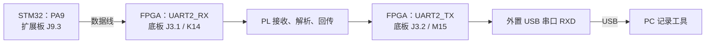

# 当前 FPGA 与 STM32 接线指南

更新日期：2026-10-29。适用于当前第三阶段程序及正式 XDC。

本指南按用户提供、并确认与实板一致的原理图编写。以下是应采用的接线方案；尚未由实际通电、万用表或逻辑分析仪验证。本次只生成文档，不表示已获准烧录或开始板测。

## 一、先看两块开发板之间的两根线

**STM32 与 FPGA 之间只接一根数据线和一根地线。两板分别按原有供电方式供电，不把两板的 3.3V、5V 电源脚互连。**

| 编号 | STM32 端：野火小智扩展板 | FPGA 端：领航者底板 | 作用 |
|---|---|---|---|
| 1 | 通讯接口 3，**J9 第 3 脚：PA9 / USART1_TX** | 扩展口 **J3 第 1 脚：UART2_RX** | STM32 将数据包发送给 FPGA；对应 FPGA K14 / pl_rx |
| 2 | 通讯接口 3，**J9 第 5 脚：GND** | 扩展口 **J3 第 37 脚：GND** | 两块开发板共地 |

STM32 扩展板通讯接口 3 的 J10 与 J9 为同信号的另一种连接器形式；若使用 J10，仍取第 3 脚 PA9 和第 5 脚 GND，二选一即可。FPGA J3 第 39 脚也是 GND，可替代第 37 脚。

**注意连接器所属板卡：这里的 FPGA J3 与 STM32 扩展板 J3 是不同连接器。请按表中板卡全名找位置。**

当前程序只从 STM32 向 FPGA 发送，STM32 的 PA10 接收功能未启用。因此不需要把 FPGA TX 接到 STM32 PA10；FPGA 的 TX 应按下一节连接 PC。

## 二、需要 PC 串口程序接收 FPGA 回传时，再接两根线

如果目前只用 DL16 在 ATK-Logic 中观察波形和解码，已有分析仪 USB 线加输入探头即可，不必新增 USB 串口模块。下面的连接用于串口助手或本项目 host/capture.py 收包、保存 CSV 的独立通道。

使用一只**已确认采用 3.3V TTL/CMOS 信号的外置 USB 串口模块**。目前没有该模块的原理图或实测电平，不能仅凭供电跳帽标注推定其 IO 电平。

| 编号 | FPGA 端：领航者底板 | 外置 USB 串口模块端 | 作用 |
|---|---|---|---|
| 3 | 扩展口 **J3 第 2 脚：UART2_TX** | **RXD** | PC 接收 FPGA 回传；对应 FPGA M15 / pl_tx |
| 4 | 扩展口 **J3 第 39 脚：GND** | **GND** | FPGA 与 USB 串口共地 |

外置模块通过 USB 接 PC。其 **TXD、VCC、3V3、5V 引脚均不接本项目两块开发板**。本方案只需要该模块接收数据。

不要用 RS-232 的 DB9 电平端口直接连接 FPGA。FPGA IO 使用 LVCMOS33，不接 5V TTL 输出。

整体连接关系如下，箭头只表示数据方向：

共地连接为：STM32 GND → FPGA J3.37，外置串口 GND → FPGA J3.39。J3.37 和 J3.39 属于同一地网络。

## 三、FPGA 底板跳帽与针号

### 1. 断开 UART2 的其它驱动

领航者底板 **P1 是 RS232/RS485 选择接口**，它与本项目 UART2_RX/TX 共用网络。首次采用上述 STM32 直连方案前，在断电状态记录原跳帽位置，并取下 P1 上连接 UART2 与 RS232/RS485 的跳帽，避免收发器输出同时驱动 UART2_RX。

这不是要求改变 FPGA 启动模式或下载设置。不要把 P1 与板载 USB 串口的 P5 混淆。

### 针对当前现场描述的更正（2026-10-29）

用户描述已接 STM32 GND→FPGA GND、PA9→K14，并把 K14(RX)↔COM2_TX、M15(TX)↔COM2_RX 通过跳帽连接。前两项符合直连方案；若后两项是底板 P1 与 COM2 的选择跳帽，应断电后取下，恢复本指南的 TTL 直连。

底板原理图第 1 页显示，P1 的 U2_TX（用户称 COM2_TX）来自 U1/SP3232 的 ROUT1 接收器输出，可经跳帽接到 UART2_RX/K14。此时 STM32 PA9 和该接收器输出可能共同驱动 K14；即使 DB9 没有接 PC，也不能假定该输出为高阻。P1 侧是收发器的逻辑电平侧，DB9 则是 RS-232 侧，不能混淆，也不能把 DB9 直接接到 STM32/FPGA GPIO。

因此，在当前方案下：保留 PA9→K14 和共地，断开 UART2 与 COM2/RS485 的跳帽，M15 只接分析仪输入以及需要时的外置 USB-TTL RXD。这里根据用户文字描述和原理图判断，尚未看到实物跳帽区域照片，不将具体插接位置记为已现场核实。

### 2. 当前不通过板载 USB 串口回传

领航者板载 USB 串口通过 P5 选择 UART1（PS）或 UART3（PL），而当前程序使用的是 **UART2 / K14、M15**。本方案不用调整 P5，PC 数据线接上一节的外置 USB 串口。

仅把 PC 的 USB 线插入领航者板载串口，不能保证看到 M15 的回传数据。若以后要改用板载 USB 串口，需要另行调整 FPGA TX 引脚与接线方案。

### 3. FPGA 扩展口 J3 的关键针脚

| 针号 | 原理图网络 | 本方案用途 |
|---|---|---|
| 1 | UART2_RX | 接 STM32 PA9 |
| 2 | UART2_TX | 接外置 USB 串口 RXD |
| 37 | GND | 接 STM32 GND |
| 38 | +3.3V | 本方案不接 |
| 39 | GND | 接外置 USB 串口 GND |
| 40 | +5V | 本方案不接 |

J3 是 2×20 扩展口，按原理图针号及实物 1 脚标记辨认。不要按“照片左边/右边”猜位置；也不要误插相邻的 J4。原理图显示 J4 为 Bank13 扩展口，仅 Zynq-7020 版本可用，本项目 Zynq-7010 使用 J3。

K14、M15、U18 是 FPGA 芯片封装引脚号，用来核对 XDC；实际用杜邦线连接的是底板排针，不需要连接或焊接芯片焊球。

## 四、MPU6050 与 STM32 的配套接线

如果当前只是用 STM32 的 FixedSource 固定数据目标验证两板通信，可以暂不接 MPU6050。使用 SensorSource 时，按下面四根线连接。

**这里采用 STM32 扩展板“通讯接口 2”，不是通讯接口 4。当前程序是 I2C2/PB10/PB11，不是之前的 PB6/PB7。**

| MPU6050 模块信号 | STM32 扩展板通讯接口 2 | 程序对应 |
|---|---|---|
| 3V3，模块第 1 脚 | **J3 第 6 脚：VCC4** | 必须选择 3.3V |
| GND，模块第 2 脚 | **J3 第 5 脚：GND** | 地 |
| SDA，模块第 3 脚 | **J3 第 4 脚：PB11** | I2C2_SDA |
| SCL，模块第 4 脚 | **J3 第 3 脚：PB10** | I2C2_SCL |
| INT，模块第 5 脚 | 不接 | 当前轮询 DATA_RDY |
| AD0，模块第 6 脚 | 不外接 | 所给模块自带下拉，地址保持 0x68 |

STM32 扩展板通讯接口 2 的 J4 与 J3 信号相同，若改用 J4，上表针号不变。此处 J3/J4 都属于 STM32 扩展板，不能与 FPGA 底板同名连接器混淆。

STM32 扩展板 **J32 的 2—3 接通时选择 VCC4=3.3V**，1—2 接通时为 5V。断电后按针号设置，并在模块接入前核对 VCC4 对 GND 的电压。不要仅凭跳帽朝向判断，更不要把 5V 直接接到本模块 3V3。

优先按上表用四根独立线连接，INT/AD0 留空，不凭六针排针的排列方向整排盲插。

## 五、STM32 的 USB 串口与其它不需要的线

- STM32 核心板默认通过跳帽把 PA9 接到板载 USB 桥 RXD。因此核心板 USB 串口可观察同一份 STM32 原始包，但该 COM 口不代表 FPGA 已正确回传。
- 本方案保留 STM32 原有 USB 串口跳帽，不把 FPGA TX 额外接到该 USB 桥 RXD，避免与 PA9 同时驱动。
- 不把 PA10 与 FPGA J3.2 相连，不连接两板的复位脚，不把 PA9 接到 FPGA TX。
- FPGA 的 50 MHz 时钟来自板载晶振 U18，不需要从 STM32 引出时钟线。
- 当前 FPGA 顶层使用内部上电复位，没有外部复位或 LED 端口；N16、J16 不需要加杜邦线。
- 本接线方案不改变 BOOT、JTAG/SWD 或烧录配置。各板按原有供电方式供电，通信靠 GND 共地。

### 当前三条电脑连线分别做什么

| 已有电脑连线 | 作用 | 是否接收当前 FPGA UART2 回包 |
|---|---|---|
| FPGA 下载器 USB/JTAG | 配置或调试 FPGA；当前设计没有自动通过 JTAG 输出串口数据 | 否 |
| STM32 DAP 的 USB/SWD | 烧录、调试 STM32；不能仅凭 DAP 已连接认定板卡供电正确 | 否 |
| DL16 的 USB | 将探头采到的波形交给 ATK-Logic 解码；必须另接输入探头及 GND | 可观察并解码 M15 波形，但不是 PC 串口 COM 收包 |

只做逻辑分析仪检查时：CH0 并接 FPGA J3.1/K14，CH1 并接 FPGA J3.2/M15，分析仪 GND 接已共地的板卡地。要观察 I2C，再按逻辑分析仪指南加 CH2/CH3。分析仪不是靠 USB 线自动读取开发板信号。

要运行 PC 串口收包：在现有三条线之外，按第二节接 USB 转 3.3V TTL 模块的 RXD/GND，再把该模块 USB 接 PC。下载器和 DAP 不代替这条通道。不要仅加领航者板载串口 USB 就认为当前 UART2 会进入该 COM 口。

还需确认两板自身供电。FPGA 下载器不作为整块领航者板的正常电源；STM32 是否已由 DAP 或其它途径供电取决于实物接法，尚未核实。各板使用符合原板说明的电源，不互连两板的 3.3V/5V。仅插下载器也不代表 FPGA 已配置为当前 top，应核对实际下载的设计。

## 六、实际操作顺序与检查表

以下步骤供后续获准接线/板测时执行，本次没有代为操作硬件。

1. 断开两块开发板及外置串口的电源、USB，记录待调整跳帽的原位置。
2. 根据丝印、原理图和针号，找到 STM32 通讯接口 3 的 PA9/GND 与 FPGA J3.1/J3.37。
3. 断开 FPGA P1 中 UART2 与 RS232/RS485 的连接。
4. 如果接传感器，将 STM32 扩展板 VCC4 选择为 3.3V；先确认电压，再断电接模块。
5. 接共地线，再接 PA9→FPGA J3.1；需要 PC 观察时再接 FPGA J3.2→外置串口 RXD 和对应地线。
6. 若要接 MPU6050，按第四节逐根连接，确认 SDA/SCL 没有互换。
7. 上电前按下表复核；随后各板按原有方式供电，后续下载与测试另按获准流程进行。

- [ ] STM32 PA9 → FPGA 底板 J3.1，而不是 J3.2。
- [ ] STM32 GND、FPGA GND、外置串口 GND 已共地。
- [ ] FPGA J3.2 → 外置 USB 串口 RXD；外置模块 TXD 留空。
- [ ] 两板 3.3V/5V 没有互连，外置串口 VCC 没有连接板卡。
- [ ] FPGA P1 没有把另一收发器输出接到 UART2_RX。
- [ ] 如接 MPU6050，VCC4 已确认 3.3V，SCL=PB10、SDA=PB11。
- [ ] 连接器针号已核对，没有依据照片朝向判断，也没有把两块板的同名 J3 搞混。

接线正确仍需运行程序验证。后续可先使用 FixedSource 和 FPGA 默认整包回传，在 PC 解码得到 X=1、Y=-1、Z=-32768，序号按模 256 递增；再切换传感器数据。ACK 模式收到 06 只证明响应，不能验证三轴内容。

目前 FPGA 正式约束与默认 PL 配置已通过综合/布局布线检查，但 DRC 仍保留 ZPS7-1 配置警告，没有生成比特流或上板；相关事项见 [FPGA 约束说明](fpga_constraints.md)。不能把本接线文档当成板测通过记录。

## 七、依据与当前程序

| 内容 | 来源与定位 |
|---|---|
| FPGA J3、UART2、共地和电源脚 | `docs/hardware/zynq_baseboard_v3_9.pdf` 第 5 页 |
| FPGA P1 与 UART2/RS232/RS485 | 同一底板原理图第 1 页 |
| FPGA K14/M15/U18 对应网络 | `docs/hardware/zynq_core_2v5.pdf` 第 3、12 页 |
| STM32 PA9、PB10/PB11、通讯接口针号 | 用户提供的扩展板原理图第 3 页 |
| STM32 VCC4/J32 | 同一扩展板原理图第 4 个 PDF 页面 |
| STM32 PA9 与板载 USB 桥默认连接 | 用户提供的核心板原理图第 5、6 页 |
| MPU6050 六针定义、AD0 下拉 | `mpu6050_module_manual.pdf` 第 5 页，`mpu6050_module_schematic.pdf` 第 1 页 |

这些内容已按实际原理图及页面图像复核；外置 USB 串口的具体型号、电平跳帽、电压测量、实物插线和最终工作现象仍未验证。没有推测实物连接器的朝向。

当前代码与进一步资料：

- [STM32 板级引脚配置](../stm32/config/board_pinmap.h)
- [FPGA 正式 XDC](../constr/top.xdc)
- [完整硬件引脚表](hardware_pinmap.md)
- [STM32 原始资料路径与核查记录](stm32_board_review.md)
- [第三阶段测试指南](stage3_test_guide.md)

本轮仅新增接线指南，并更新 README 导航及 AI 日志；未修改源码、约束、协议、跳帽或烧录设置。由于只修改文档，未重复执行 ModelSim、Vivado 或 Keil 构建。
